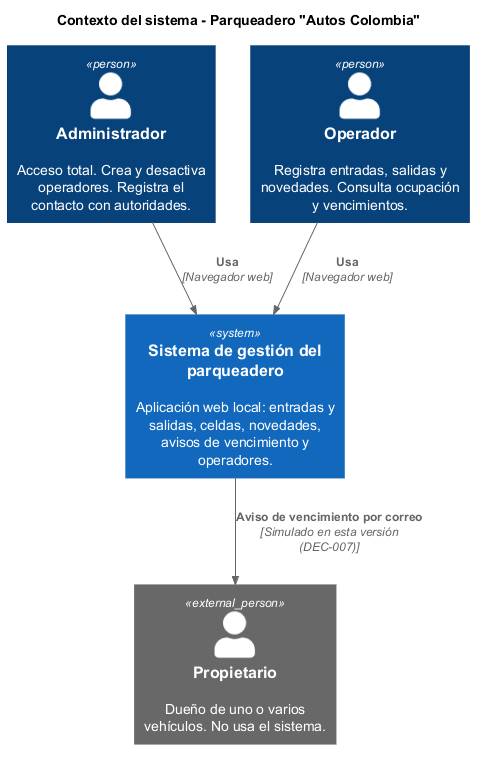
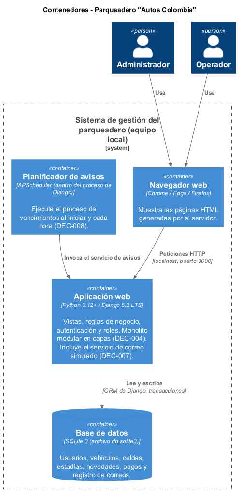
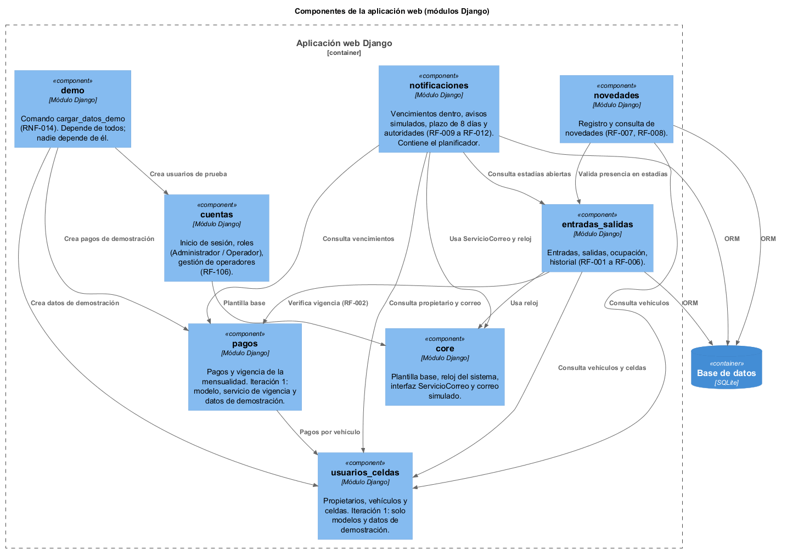
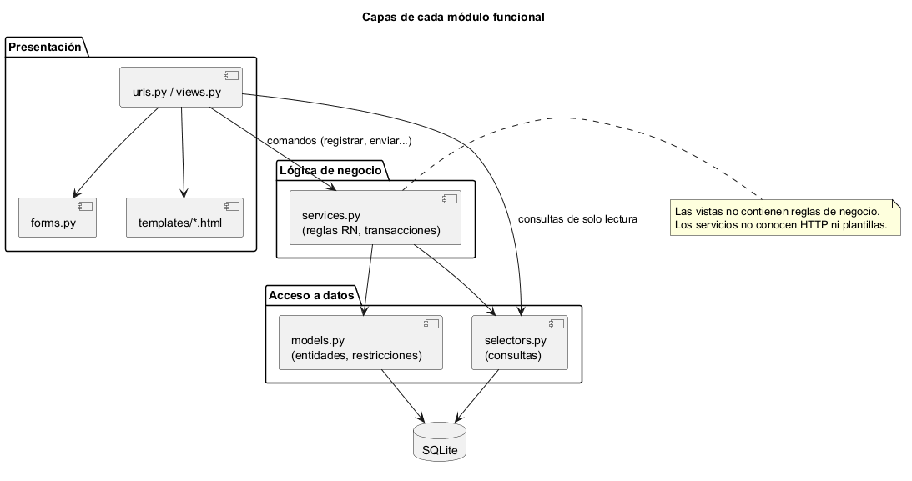
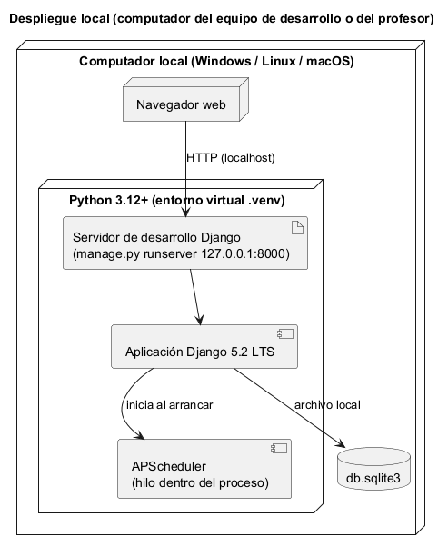

# Arquitectura del sistema — Parqueadero "Autos Colombia"

**Versión:** 1
**Fecha:** 2026-11-15
**Base:** Requerimientos v2.9, Historias de usuario HU-001 a HU-011 y decisiones DEC-001 a DEC-011 (todo aprobado).
**Estado:** **Aprobado** por el equipo del proyecto el 2026-11-15.

Los diagramas se generan con PlantUML. Las fuentes están en `docs/latex/diagrams/arquitectura/` (`.puml` y `.png`).

---

## 1. Factores que guían la arquitectura

| Factor | Origen | Respuesta arquitectónica |
|---|---|---|
| Ejecución local; el profesor la ejecuta en su máquina | P-09, RNF-011, RNF-014 | Aplicación web local, SQLite, instalación con `pip`, comando de datos de demostración. |
| Entrega en tres iteraciones | Proceso del equipo, DEC-001 | Monolito modular: un módulo Django por área funcional; el modelo de datos completo existe desde la iteración 1. |
| Reglas de negocio verificables | RNF-008 | Reglas en una capa de servicios, separada de las vistas y probada con pruebas automatizadas. |
| Integridad de celdas y entradas | RN-04, RN-05, RNF-003 | Transacciones y restricciones de unicidad en la propia base de datos. |
| Seguridad y roles | RNF-001, RNF-002, RNF-007 | Autenticación de Django, roles Administrador/Operador y control de acceso en cada vista. |
| Avisos automáticos simulados | DEC-002, DEC-007, DEC-008, RN-21 | APScheduler dentro del proceso; envío detrás de la interfaz `ServicioCorreo`, con implementación simulada. |
| Fechas y plazos (8 días, medianoche) | RN-12, RNF-010, RNF-014 | Zona horaria `America/Bogota`; un "reloj" del sistema que se puede sustituir en las pruebas. |

---

## 2. Vista de contexto (C4 nivel 1) — ARQ-01



- El **Administrador** y el **Operador** usan el sistema desde el navegador.
- El **Propietario** no usa el sistema: solo recibiría el aviso de vencimiento, que en esta versión es simulado (DEC-007).
- En esta versión no hay sistemas externos conectados.

---

## 3. Vista de contenedores (C4 nivel 2) — ARQ-02



| Contenedor | Tecnología | Responsabilidad |
|---|---|---|
| Navegador web | Cualquier navegador moderno | Muestra las páginas HTML generadas por el servidor (sin una aplicación de una sola página separada, DEC-005). |
| Aplicación web | Python 3.12+ y Django 5.2 LTS (DEC-005, DEC-010) | Vistas, reglas de negocio, autenticación, roles y envío simulado de correos. |
| Planificador de avisos | APScheduler, dentro del mismo proceso (DEC-008) | Ejecuta el proceso de vencimientos al iniciar y cada hora. |
| Base de datos | SQLite 3, archivo `db.sqlite3` (DEC-006) | Persistencia de todas las entidades. |

---

## 4. Vista de componentes (C4 nivel 3) — ARQ-03



### 4.1. Módulos y responsabilidades

| Módulo (app Django) | Responsabilidad | RF / HU | Iteración en que se implementan las pantallas |
|---|---|---|---|
| `core` | Plantilla base, menú por rol, reloj del sistema, interfaz `ServicioCorreo` y su implementación simulada. No depende de ningún otro módulo. | — | 1 |
| `demo` | Comando `cargar_datos_demo`. Es el único módulo que depende de todos los demás, porque crea datos de cada uno. Ningún módulo depende de él. | RNF-014 | 1 |
| `cuentas` | Inicio y cierre de sesión, roles, crear y desactivar operadores. | RF-106 (básico), HU-010 | 1 |
| `usuarios_celdas` | Propietarios, vehículos y celdas. | RF-101 a RF-105 | 2 (en la iteración 1 solo modelos y datos de demostración) |
| `pagos` | Pagos, tarifas y vigencia de la mensualidad. | RF-201 a RF-204 | 3 (en la iteración 1: modelo, servicio de vigencia y datos de demostración) |
| `entradas_salidas` | Entradas, salidas, ocupación, consulta de celda, historial. | RF-001 a RF-006, HU-001 a HU-004 | 1 |
| `novedades` | Registro y consulta de novedades con varios vehículos. | RF-007, RF-008, HU-005, HU-006 | 1 |
| `notificaciones` | Vehículos dentro con mensualidad vencida, avisos simulados (automáticos y manuales), plazo de 8 días y contacto con autoridades; planificador. | RF-009 a RF-012, HU-007 a HU-009, HU-011 | 1 |

### 4.2. Reglas de dependencia entre módulos

- Las dependencias van en un solo sentido, **sin ciclos**. `core` es la base y no depende de nadie; `demo` está en el extremo opuesto:
  `notificaciones → entradas_salidas → pagos → usuarios_celdas → core`, y `novedades → entradas_salidas`.
- `pagos` **no** depende de `notificaciones`. RN-17 (si paga, sale del proceso de retiro) no necesita eventos: la lista de RF-009 se calcula consultando la vigencia en cada momento.
- Un módulo usa a otro **solo a través de sus servicios y consultas públicas** (`services.py`, `selectors.py`), nunca modificando directamente sus modelos.

---

## 5. Capas dentro de cada módulo — ARQ-05



| Capa | Archivos | Puede | No puede |
|---|---|---|---|
| Presentación | `urls.py`, `views.py`, `forms.py`, `templates/` | Validar el formato de las entradas, llamar a servicios y consultas, controlar el acceso por rol. | Contener reglas de negocio ni escribir en la base de datos directamente. |
| Lógica de negocio | `services.py` | Aplicar las reglas RN, abrir transacciones y usar el reloj y el `ServicioCorreo`. | Conocer HTTP, sesiones o plantillas. |
| Acceso a datos | `models.py`, `selectors.py` | Definir entidades y restricciones; hacer consultas. | Contener reglas de negocio de flujo. |

---

## 6. Vista de despliegue — ARQ-04



- Un solo computador ejecuta todo: el navegador, Python en un entorno virtual con Django y APScheduler, y el archivo SQLite.
- Se ejecuta con `python manage.py runserver` en `127.0.0.1:8000`.
- **Limitación conocida:** el servidor de desarrollo de Django no está pensado para producción. Para la demostración académica en local es suficiente. Un uso real 24/7 necesitaría un servidor WSGI, lo que queda fuera del alcance (P-09).

---

## 7. Mecanismos transversales

### 7.1. Autenticación y autorización (RNF-001, RNF-002)

- **Modelo de usuario propio** (`cuentas.Usuario`, que extiende el usuario de Django) desde la primera migración. Django recomienda definirlo al inicio, porque cambiarlo después es costoso.
- **Rol:** un campo `rol` con valores `ADMINISTRADOR` u `OPERADOR`. Es más simple que los grupos de Django para solo dos roles fijos, y se verifica con un decorador o mixin en cada vista.
- Las vistas exigen sesión iniciada. Un usuario desactivado no puede iniciar sesión (RF-106).
- **Algoritmo de contraseñas:** Argon2 con `argon2-cffi` (DEC-012, aprobada).

### 7.2. Integridad y concurrencia (RN-04, RN-05, RNF-003)

- Las entradas y salidas se ejecutan dentro de `transaction.atomic()`.
- La base de datos impone las reglas, no solo el código:
  - "un vehículo con una sola estadía abierta": restricción única **parcial** sobre el vehículo cuando la fecha de salida es nula;
  - "una celda con un solo vehículo": restricción única **parcial** sobre la celda cuando la fecha de salida es nula.
- Si dos registros simultáneos chocan, la base de datos rechaza uno y el servicio lo traduce al mensaje de negocio correspondiente.

### 7.3. Fechas, zona horaria y reloj (RN-12, RNF-004, RNF-010)

- `TIME_ZONE = "America/Bogota"` y `USE_TZ = True`. Las fechas y horas se toman siempre del servidor.
- Un componente **Reloj** en `core` devuelve "ahora" y "hoy". Las pruebas lo sustituyen para simular vencimientos, el día 8 y el día 9 o la medianoche sin esperar fechas reales.

### 7.4. Correo simulado (DEC-007, RN-11, RN-21, RN-22)

- La interfaz `ServicioCorreo` tiene un método para enviar un mensaje. En esta versión su implementación es `ServicioCorreoSimulado`, que no contacta ningún servidor.
- Cada intento se registra en la base de datos con el vehículo, el vencimiento, el destinatario, el texto, el origen (automático o manual), el usuario (si es manual), la fecha y hora y el resultado.
- En `notificaciones/services.py`, un **servicio de avisos** aplica:
  - un solo envío automático por vencimiento (RN-11), con recuperación de los pendientes al iniciar (RN-21);
  - reenvío manual con confirmación, como máximo un reenvío (RN-22).
- Conectar un correo real en el futuro solo requiere otra implementación de `ServicioCorreo` (RNF-012).

### 7.5. Planificador (DEC-008)

- APScheduler se inicia una sola vez, cuando la aplicación arranca. En modo desarrollo, la recarga automática de Django crea dos procesos; el arranque se protege para que el planificador se ejecute solo en uno.
- Tareas: el proceso de avisos al iniciar y luego cada hora. El proceso es idempotente.
- El mismo proceso también se puede ejecutar con el comando `python manage.py enviar_avisos_vencimiento`, útil para pruebas.

### 7.6. Trazabilidad y no borrado (RN-07, RNF-004)

- Las entidades de estadías, novedades, avisos y contactos con autoridades guardan el usuario y la fecha y hora del servidor.
- La aplicación no ofrece borrado de esos registros. No se habilita el panel `/admin` de Django (DEC-011).

### 7.7. Manejo de errores

- Los servicios lanzan excepciones de negocio con un mensaje para el usuario (por ejemplo, "Mensualidad no vigente"). Las vistas las muestran sin detalles técnicos.
- Los errores inesperados se registran en el log y el usuario ve un mensaje genérico.

---

## 8. Estructura de carpetas propuesta

```
Ingenieria de Software/          (raíz del repositorio)
├── docs/                         documentación (Markdown + LaTeX)
├── src/
│   ├── manage.py
│   ├── config/                   settings.py, urls.py, wsgi.py
│   ├── apps/
│   │   ├── core/
│   │   ├── cuentas/
│   │   ├── usuarios_celdas/
│   │   ├── pagos/
│   │   ├── entradas_salidas/
│   │   ├── novedades/
│   │   ├── notificaciones/
│   │   └── demo/
│   ├── templates/                plantilla base compartida
│   └── static/                   CSS
├── requirements.txt              versiones fijadas
├── README.md                     instalación, ejecución, usuarios de demostración
└── tools/                        plantuml.jar (no se versiona)
```

Cada módulo de `apps/` tiene `models.py`, `services.py`, `selectors.py`, `views.py`, `forms.py`, `urls.py`, `templates/<módulo>/` y `tests/`.

---

## 9. Dependencias previstas

| Dependencia | Uso | Aprobada en |
|---|---|---|
| Django 5.2 LTS | Framework | DEC-005, DEC-010 |
| APScheduler (versión estable más reciente, a fijar por el Ingeniero) | Planificador | DEC-008 |
| argon2-cffi | Hash de contraseñas con Argon2 | DEC-012 |

No se usan frameworks de CSS externos que haya que descargar. Los estilos son CSS propio y sencillo; si más adelante se quiere uno, se decidirá aparte.

---

## 10. Cobertura de requerimientos no funcionales

| RNF | Cómo lo cubre la arquitectura |
|---|---|
| RNF-001 | Autenticación de Django + Argon2 (DEC-012). |
| RNF-002 | Campo `rol` y control de acceso en cada vista (7.1). |
| RNF-003 | Transacciones y restricciones únicas parciales (7.2). |
| RNF-004 | Usuario y hora del servidor en cada registro; sin borrado (7.6). |
| RNF-005 | Formularios de entrada y salida con la placa y una confirmación. Se valida con los mockups. |
| RNF-006 | Índices sobre la placa, la celda y las estadías abiertas, definidos en el modelo físico. Se mide en las pruebas. |
| RNF-007 | Datos personales solo visibles con sesión iniciada y según el rol. |
| RNF-008 | Capas y módulos (4, 5) + pruebas por módulo. |
| RNF-009 | El README documenta la copia y restauración de `db.sqlite3`. |
| RNF-010 | Sin restricciones de horario; zona horaria y reloj (7.3). |
| RNF-011 | Instalación con `pip install -r requirements.txt`, sin servicios externos. |
| RNF-012 | Sin credenciales en esta versión; interfaz preparada para un correo real (7.4). |
| RNF-013 | El fallo del envío simulado se registra y no afecta las entradas ni las salidas (7.4). |
| RNF-014 | Comando `cargar_datos_demo` en el módulo `demo`, usando el reloj (7.3). |

---

## 11. Decisión surgida en este documento

**DEC-012 — Algoritmo de hash de contraseñas:** aprobada el 2026-11-15 con la alternativa A (Argon2 con `argon2-cffi`). El detalle está en el Registro de decisiones.
