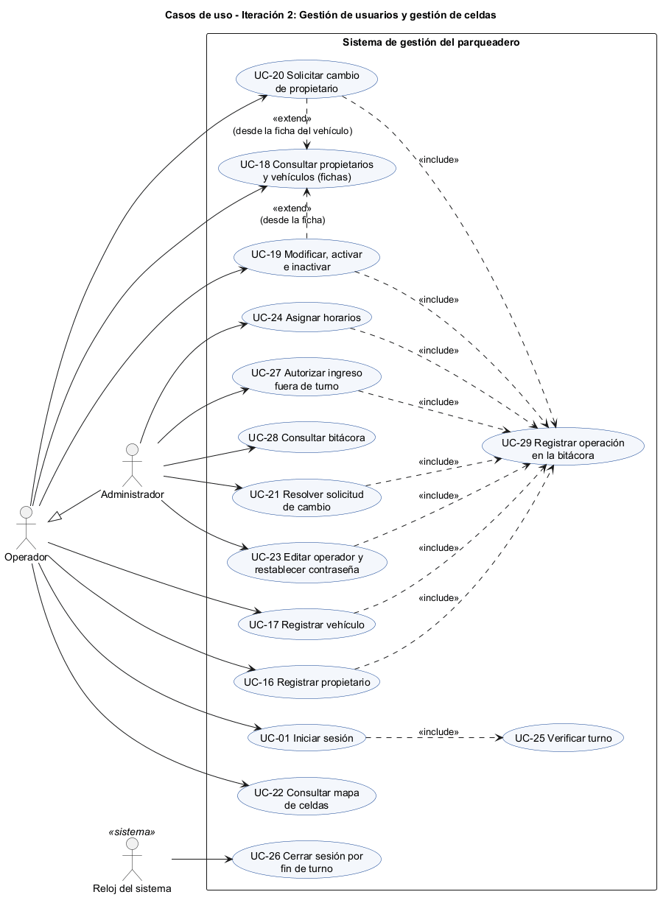
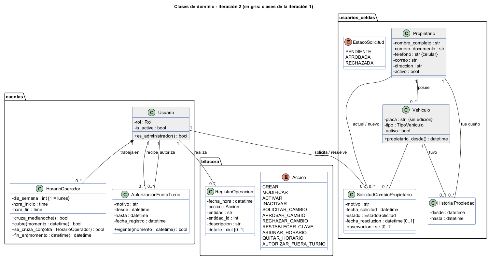
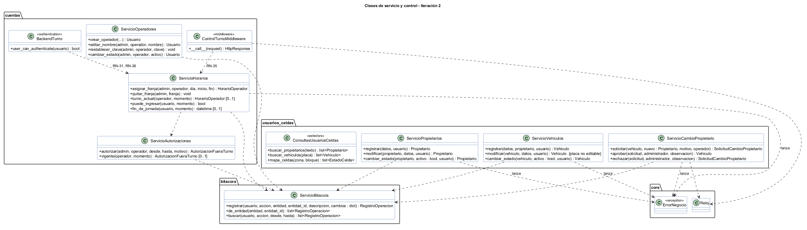
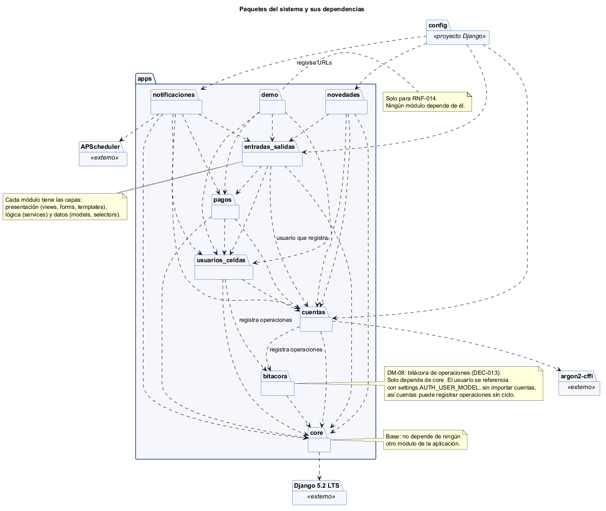

# Diseño — Iteración 2: Gestión de usuarios y gestión de celdas

**Versión:** 1 · **Fecha:** 2026-11-15 · **Estado:** **Aprobado** por el equipo del proyecto el 2026-11-15 (incluye la corrección de DM-08 y el mecanismo de control de turno).
**Base (aprobado):** Requerimientos iteración 2 v1.4 · HU-012 a HU-023 · Modelo de datos v1.3 · DEC-013 a DEC-015.

Contenido: mockups (M-13 a M-25), casos de uso (UC-16 a UC-29), clases (CL-03, CL-04), paquetes (PK-01 v2), componentes (ARQ-03 v2) y el mecanismo de control de turno. Los diagramas están en `docs/latex/diagrams/` (`mockups/`, `uml/` y `arquitectura/`).

---

## 1. Mockups (M-13 a M-25)

Mismo estilo visual de las referencias (CHG-002). El menú lateral agrega una sección **Clientes**, con Propietarios, Vehículos y Mapa de celdas, y amplía **Administración**, con Operadores, Horarios, Autorizaciones, Solicitudes y Bitácora.

| Mockup | Pantalla | HU |
|---|---|---|
| M-13 | Propietarios: búsqueda y lista | HU-014 |
| M-14 | Registrar o editar propietario (validación del celular) | HU-012, HU-015 |
| M-15 | Ficha del propietario: datos, vehículos (dentro o fuera) y bitácora | HU-014, HU-015 |
| M-16 | Registrar o editar vehículo (búsqueda del propietario; la placa no se edita) | HU-013, HU-015 |
| M-17 | Ficha del vehículo: propietario actual, historial de propietarios, bitácora y botón "Solicitar cambio" | HU-014, HU-016 |
| M-18 | Solicitar cambio de propietario | HU-016 |
| M-19 | Bandeja de solicitudes: aprobar o rechazar con observación (administrador) | HU-017 |
| M-20 | Mapa de celdas por zona (bloques de 24, con la placa en las ocupadas) | HU-018 |
| M-21 | Operadores: editar, restablecer contraseña, horario y desactivar (administrador) | HU-019 |
| M-22 | Horario del operador: franjas por día, turno nocturno y error de franjas cruzadas | HU-020 |
| M-23 | Control de turno: mensajes al iniciar sesión, horas del turno en el encabezado y avisos de cierre | HU-021 |
| M-24 | Autorizaciones fuera de turno (administrador) | HU-022 |
| M-25 | Bitácora de operaciones con filtros (administrador) | HU-023 |

---

## 2. Casos de uso (UC-02)

**Actores:** Operador; Administrador (especializa al Operador); **Reloj del sistema**, que dispara el cierre de sesión al terminar el turno.

**Relaciones:**
- **UC-01 Iniciar sesión «include» UC-25 Verificar turno.**
- Todos los casos que modifican datos «include» **UC-29 Registrar operación en la bitácora**.
- UC-19 (modificar) y UC-20 (solicitar cambio) «extend» UC-18, desde la ficha.

### Especificaciones

| UC | Actor | Flujo principal | Alternativos y excepciones | Trazabilidad |
|---|---|---|---|---|
| **UC-16** Registrar propietario | Operador | Llena los 5 datos → se valida → se guarda activo → UC-29. | Cédula repetida; celular inválido; correo inválido; campo vacío. | RF-101, HU-012 |
| **UC-17** Registrar vehículo | Operador | Busca al propietario por cédula → llena los datos → la placa se normaliza → se valida → se guarda → UC-29. | Placa que no corresponde al tipo; placa repetida; propietario inactivo; modelo fuera de rango. | RF-102, HU-013 |
| **UC-18** Consultar propietarios y vehículos | Operador | Busca por nombre, cédula o placa → abre la ficha (datos, vehículos o historial, bitácora del registro). | Sin resultados. | RF-108, HU-014 |
| **UC-19** Modificar, activar e inactivar | Operador | Desde la ficha: edita (la placa no) o cambia el estado → UC-29 con los valores antes y después. | Datos inválidos. Inactivar con el vehículo dentro: permite la salida pero no la entrada (RN-29). | RF-105, HU-015 |
| **UC-20** Solicitar cambio de propietario | Operador | Desde la ficha del vehículo: elige el nuevo propietario y el motivo → solicitud pendiente → UC-29. | Ya hay una pendiente; mismo propietario; nuevo propietario inactivo. | RF-109, HU-016 |
| **UC-21** Resolver solicitud | Administrador | Bandeja → aprobar: en una transacción se guarda el historial del propietario anterior, se cambia el propietario y se marca la solicitud como aprobada → UC-29. Rechazar: con una observación. | Solicitud ya resuelta; acceso de un operador → 403. | RF-109, HU-017 |
| **UC-22** Consultar mapa de celdas | Operador | Elige la zona y el bloque → ve libres y ocupadas, con las placas y los contadores. | — | RF-104, HU-018 |
| **UC-23** Editar operador y restablecer contraseña | Administrador | Edita el nombre o asigna una contraseña nueva (validada y guardada con Argon2) → UC-29, sin guardar la contraseña. | Contraseña débil; confirmación distinta. | RF-106, HU-019 |
| **UC-24** Asignar horarios | Administrador | Agrega una franja (día, desde, hasta) → valida que no se cruce con otra → guarda → UC-29. Quitar una franja → UC-29. | Franja cruzada (RN-37); inicio igual al fin. | RF-107, HU-020 |
| **UC-25** Verificar turno | Sistema (incluido en UC-01) | Administrador: siempre puede ingresar. Operador: debe tener horario (RN-36) y estar dentro de una franja o de una autorización vigente (RN-31, RN-32). | Fuera de turno; sin horario → mensaje y no ingresa. | RN-31, RN-32, RN-36, HU-021 |
| **UC-26** Cerrar sesión por fin de turno | Reloj del sistema | Al terminar la franja o la autorización: si no hay un registro en curso → aviso y 5 minutos → cierre. Si hay un registro en curso → no cierra mientras el operador escriba; al guardar o cancelar → cierre. Si pasan 5 minutos sin escribir → aviso y 5 minutos más → cierre. | Autorización vigente → no se cierra. | RN-35, HU-021 |
| **UC-27** Autorizar ingreso fuera de turno | Administrador | Elige el operador, desde, hasta y el motivo → se guarda → UC-29. | Hasta ≤ desde; autorizarse a sí mismo. | RF-110, HU-022 |
| **UC-28** Consultar bitácora | Administrador | Filtra por usuario, acción y fechas → lista con el detalle de los cambios. | Un operador recibe 403 en la bitácora completa; ve la de cada registro en su ficha (UC-18). | RF-111, HU-023 |
| **UC-29** Registrar operación en la bitácora | Sistema (incluido) | Guarda el usuario, la fecha y hora, la acción, la entidad, el id, la descripción y los cambios (sin contraseñas). | — | RN-34, DEC-013 |

---

## 3. Clases

### 3.1. Dominio (CL-03)

Clases nuevas: `AutorizacionFueraTurno`, `SolicitudCambioPropietario`, `HistorialPropiedad` y `RegistroOperacion`. `HorarioOperador` queda definitiva, con métodos de dominio:
- `cruza_medianoche()`;
- `cubre(momento)`: si el momento está dentro de la franja, incluido el tramo después de medianoche de una franja del día anterior;
- `se_cruza_con(otra)`: para RN-37;
- `fin_en(momento)`: cuándo termina la franja que cubre ese momento.

`Vehiculo.propietario_desde()` calcula desde cuándo el propietario actual es dueño (DM-09).

### 3.2. Servicios y control (CL-04)

| Clase | Responsabilidad |
|---|---|
| `ServicioPropietarios`, `ServicioVehiculos` | Registrar, modificar y cambiar el estado, con validaciones (RN-23, RN-25, RN-26, RN-30) y registro en la bitácora. |
| `ServicioCambioPropietario` | Solicitar; aprobar en una transacción (historial + cambio + estado); rechazar. |
| `ConsultasUsuariosCeldas` | Búsquedas, fichas y mapa de celdas (solo lectura). |
| `ServicioOperadores` (ampliado) | Editar el nombre y restablecer la contraseña. |
| `ServicioHorarios` | Asignar y quitar franjas (RN-37); `puede_ingresar()` (RN-31, RN-36); `fin_de_jornada()` (franja o autorización). |
| `ServicioAutorizaciones` | Crear autorizaciones y consultar la vigente. |
| `ServicioBitacora` | Registrar y consultar operaciones (DEC-013). |
| `BackendTurno` | Backend de autenticación de Django: rechaza el inicio de sesión fuera de turno o sin horario (UC-25). |
| `ControlTurnoMiddleware` | Aplica RN-35 en cada petición (sección 5). |

---

## 4. Paquetes y componentes (PK-01 v2, ARQ-03 v2)

- **Módulo nuevo `bitacora`** (DM-08, aprobado con el modelo v1.3).
- **Corrección de DM-08 detectada al dibujar el diagrama.** El texto aprobado dice que `bitacora` "depende de `core` y `cuentas`", pero `cuentas` también registra operaciones en la bitácora (operadores, horarios y autorizaciones), y eso formaría un **ciclo**. Para evitarlo, propongo que `bitacora` **solo dependa de `core`** y referencie al usuario con `settings.AUTH_USER_MODEL`, el mecanismo estándar de Django, sin importar `cuentas`. Así `cuentas` y `usuarios_celdas` dependen de `bitacora`, y no al revés. Las tablas y las relaciones del modelo no cambian.
- `usuarios_celdas` y `cuentas` dependen de `bitacora`; `usuarios_celdas` también de `cuentas` (usuario que solicita o resuelve).
- ARQ-03 se actualizó con el módulo `bitacora` y las nuevas responsabilidades de `cuentas` y `usuarios_celdas`.

---

## 5. Mecanismo de control de turno (RN-31, RN-35, RN-36)

| Momento | Dónde | Qué hace |
|---|---|---|
| Inicio de sesión | `BackendTurno` (servidor) | Si el operador no tiene horario o está fuera de su franja sin una autorización vigente, no lo deja entrar y muestra el mensaje de M-23. |
| Cada petición | `ControlTurnoMiddleware` (servidor) | Calcula el fin de la jornada (franja o autorización). Si ya pasó: (1) una petición que **guarda un registro** (POST) se completa y después se cierra la sesión; (2) en cualquier otra petición, si pasaron más de 5 minutos de gracia desde el fin, se cierra la sesión. |
| En la página | Script "vigilante de sesión" (navegador) | Recibe la hora de fin de la jornada. Al llegar a esa hora: si no hay un formulario empezado, muestra el aviso con cuenta regresiva de 5 minutos y luego cierra la sesión. Si hay un formulario empezado y el operador escribe, no hace nada. Si pasan 5 minutos sin escribir, muestra el aviso y empieza otra cuenta de 5 minutos; si vuelve a escribir, el aviso desaparece. |

**Por qué en dos lugares:** el servidor no puede saber si el operador está escribiendo; el navegador sí. El servidor es la barrera de seguridad: aunque se desactive el script, la sesión no sigue abierta más allá de la gracia, salvo para completar el guardado en curso.

**Limitación:** si el operador cierra la pestaña sin cerrar sesión, la sesión se cierra en la siguiente petición o cuando expire la cookie de sesión. Propongo que la cookie de sesión de los operadores dure como máximo 12 horas.

---

## 6. Aprobado el 2026-11-15

1. Los mockups M-13 a M-25.
2. Los casos de uso UC-16 a UC-29 y los diagramas CL-03, CL-04, PK-01 v2 y ARQ-03 v2.
3. **La corrección de DM-08:** `bitacora` solo depende de `core`.
4. **El mecanismo de control de turno** (sección 5), incluida la duración máxima de 12 horas de la sesión del operador.
