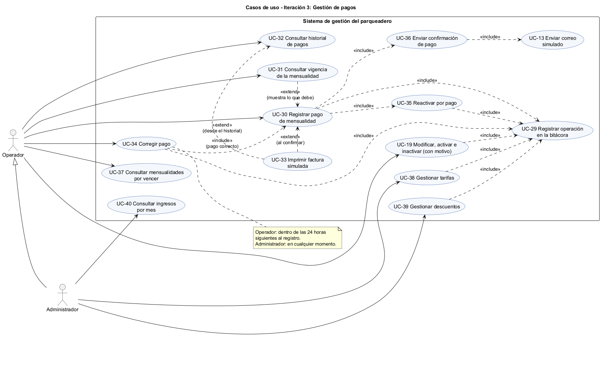
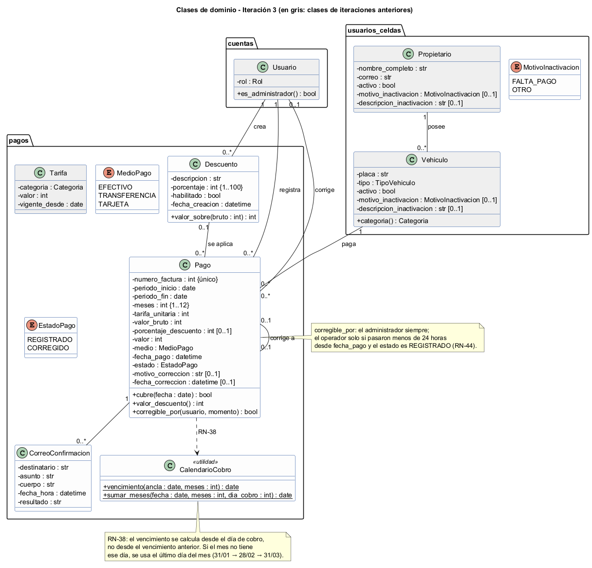
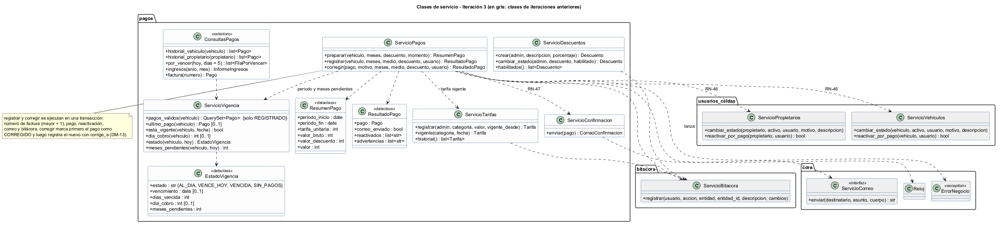
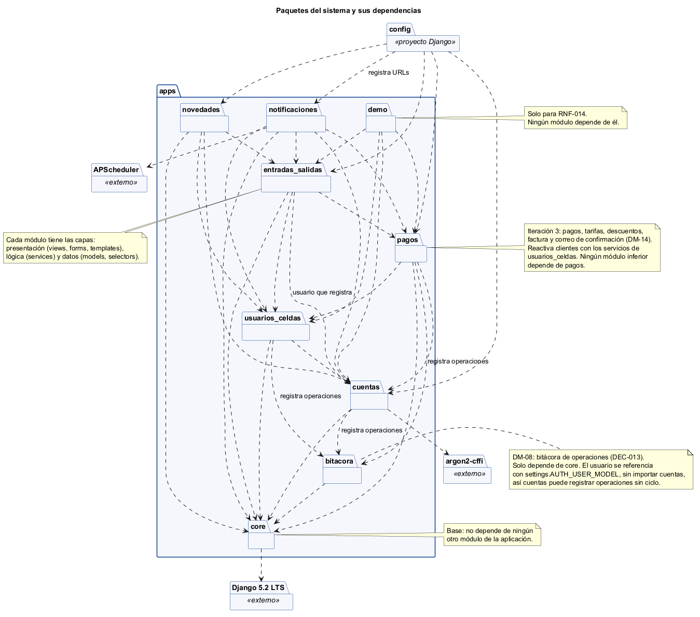

# Diseño — Iteración 3: Gestión de pagos

**Versión:** 1 · **Fecha:** 2026-11-20 · **Estado:** **Aprobado** por el equipo del proyecto el 2026-11-20 (incluye la regla de corregir solo el último pago).
**Base (aprobado):** Requerimientos iteración 3 v1.2 · HU-024 a HU-032 · Modelo de datos v1.4 (DM-12 a DM-19).

Contenido: mockups (M-26 a M-35), casos de uso (UC-30 a UC-40), clases (CL-05, CL-06), paquetes (PK-01 v3), componentes (ARQ-03 v3) y los mecanismos de cálculo del periodo, corrección, factura y numeración. Los diagramas están en `docs/latex/diagrams/` (`mockups/`, `uml/` y `arquitectura/`).

---

## 1. Mockups (M-26 a M-35)

Mismo estilo visual de las iteraciones anteriores. El menú lateral agrega una sección **Pagos**, con Registrar pago y Por vencer, y amplía **Administración** con Tarifas, Descuentos e Ingresos. La ficha del vehículo y la del propietario (iteración 2) agregan los botones **Pagos y vigencia** y **Registrar pago**.

| Mockup | Pantalla | HU |
|---|---|---|
| M-26 | Registrar pago: búsqueda por placa, estado de la mensualidad, meses pendientes, meses, medio, descuento y resumen calculado antes de confirmar | HU-024, HU-025 |
| M-27 | Pago registrado: factura, correo enviado, reactivación automática y advertencias (sigue vencido; inactivo por otro motivo) | HU-024, HU-028 |
| M-28 | Factura simulada para imprimir, con la marca "Simulación – sin validez fiscal" y el sello "Anulada" si fue corregida | HU-026, HU-029 |
| M-29 | Vigencia e historial de pagos de un vehículo o de un propietario, con botones Factura y Corregir | HU-025, HU-026 |
| M-30 | Corregir pago: motivo obligatorio y datos correctos con el nuevo total | HU-029 |
| M-31 | Tarifas: actuales, registrar nueva con "vigente desde" e historial (administrador) | HU-027 |
| M-32 | Descuentos: crear, habilitar y deshabilitar (administrador) | HU-031 |
| M-33 | Inactivar con motivo y ficha del vehículo con el motivo | HU-028 |
| M-34 | Mensualidades por vencer en los próximos 5 días | HU-030 |
| M-35 | Ingresos por mes, por tipo de vehículo y por medio de pago (administrador) | HU-032 |

---

## 2. Casos de uso (UC-03)

**Actores:** Operador; Administrador (especializa al Operador).

**Relaciones:**
- UC-30 Registrar pago «include» UC-35 Reactivar por pago y UC-36 Enviar confirmación, que a su vez «include» UC-13 Enviar correo simulado (iteración 1).
- UC-34 Corregir pago «include» UC-30, porque registra el pago correcto.
- UC-33 Imprimir factura «extend» UC-30 (al confirmar) y UC-32 (desde el historial). UC-31 «extend» UC-30 (muestra lo que se debe).
- Los casos que modifican datos «include» UC-29 Registrar operación en la bitácora.
- UC-19 (iteración 2) cambia: inactivar pide el motivo.

### Especificaciones

| UC | Actor | Flujo principal | Alternativos y excepciones | Trazabilidad |
|---|---|---|---|---|
| **UC-30** Registrar pago | Operador | Busca la placa → ve el vehículo, el estado y los meses pendientes → elige meses, medio y descuento → el sistema muestra el periodo y el valor → confirma → en una transacción: número de factura, pago, UC-35, UC-36 y UC-29 → M-27. | Placa inexistente; meses fuera de 1..12; sin medio de pago; descuento deshabilitado mientras se llenaba; no hay tarifa vigente; pago que no alcanza a dejarlo al día (se guarda y advierte). | RF-201, HU-024 |
| **UC-31** Consultar vigencia | Operador | Abre la página de pagos del vehículo → ve el estado, el vencimiento, el día de cobro y los meses pendientes. | Sin pagos. | RF-202, HU-025 |
| **UC-32** Consultar historial | Operador | Desde la ficha del vehículo o del propietario → lista de pagos, del más reciente al más antiguo, con su estado. | Sin pagos. | RF-203, HU-026 |
| **UC-33** Imprimir factura | Operador | Abre la factura → la página se muestra lista para imprimir → el navegador la imprime o la guarda como PDF. | Pago corregido: sello "Anulada" con el número de la factura nueva. | RN-47, HU-026 |
| **UC-34** Corregir pago | Operador, Administrador | Elige el pago → escribe el motivo y los datos correctos → en una transacción: marca el pago como corregido, UC-30 con `corrige_a`, UC-29. | Sin motivo; operador con un pago de más de 24 horas → mensaje; pago ya corregido → sin opción. | RF-206, HU-029 |
| **UC-35** Reactivar por pago | Sistema (incluido en UC-30) | Si después del pago el vehículo queda al día: reactiva el vehículo y su propietario si estaban inactivos por falta de pago → UC-29. | Inactivo por "Otro" → advertencia, no se reactiva. Pago que no lo deja al día → no se reactiva. | RN-46, HU-028 |
| **UC-36** Enviar confirmación | Sistema (incluido en UC-30) | Arma el correo con el periodo, el valor y el número de factura → UC-13 → guarda el resultado. | Fallo del envío → se guarda como FALLIDO; el pago no se deshace. | RN-47, HU-024 |
| **UC-37** Consultar por vencer | Operador | Lista de vehículos activos que vencen hoy o en los próximos 5 días, con el propietario y su celular. | Lista vacía. | RF-207, HU-030 |
| **UC-38** Gestionar tarifas | Administrador | Registra tipo, valor y fecha "vigente desde" → UC-29. | Fecha repetida para el tipo; valor ≤ 0; acceso de un operador → 403. | RF-204, HU-027 |
| **UC-39** Gestionar descuentos | Administrador | Crea con descripción y porcentaje; habilita o deshabilita → UC-29. | Porcentaje fuera de 1..100; descripción vacía; acceso de un operador → 403. | RF-208, HU-031 |
| **UC-40** Consultar ingresos | Administrador | Elige el mes → total, por tipo y por medio, sin pagos corregidos. | Mes sin pagos; acceso de un operador → 403. | RF-209, HU-032 |

---

## 3. Clases

### 3.1. Dominio (CL-05)

- `Pago` amplía sus atributos según el modelo v1.4 y agrega `valor_descuento()` y `corregible_por(usuario, momento)` (RN-44).
- `Descuento` (nueva) con `valor_sobre(bruto)`: redondeo hacia abajo (DM-16).
- `CorreoConfirmacion` (nueva).
- `CalendarioCobro`: funciones puras del calendario de cobro (sección 5.1).
- `Propietario` y `Vehiculo` agregan el motivo de inactivación.

### 3.2. Servicios (CL-06)

| Clase | Responsabilidad |
|---|---|
| `ServicioVigencia` (ampliado) | Solo cuenta pagos REGISTRADOS. Día de cobro (DM-12), estado de la mensualidad y meses pendientes. Las funciones `ultimo_pago` y `esta_vigente` conservan su nombre, así la entrada, los avisos y el mapa siguen funcionando. |
| `ServicioPagos` | `preparar` (resumen sin guardar, para M-26), `registrar` y `corregir`, cada uno en una transacción. |
| `ServicioTarifas` | Registrar tarifas y obtener la vigente en una fecha. |
| `ServicioDescuentos` | Crear, habilitar y deshabilitar descuentos. |
| `ServicioConfirmacion` | Enviar el correo simulado con el `ServicioCorreo` de `core` y guardarlo. |
| `ConsultasPagos` | Historiales, factura, por vencer e ingresos (solo lectura). |
| `ServicioPropietarios`, `ServicioVehiculos` (ampliados) | `cambiar_estado` recibe el motivo; `reactivar_por_pago` solo reactiva si el motivo es FALTA_PAGO. |

---

## 4. Paquetes y componentes (PK-01 v3, ARQ-03 v3)

- **No hay módulos nuevos.** Todo va en `pagos`.
- **Dependencia nueva: `pagos` → `bitacora`.** No crea ciclos, porque `bitacora` solo depende de `core`.
- `pagos` llama a los servicios de `usuarios_celdas` para reactivar (ya dependía de ese módulo).
- La ficha del vehículo (en `usuarios_celdas`) enlaza a las páginas de `pagos` por el nombre de la URL, sin importar el módulo. Así no se forma un ciclo, igual que en la iteración 2 con las estadías.
- ARQ-03 se actualizó con las nuevas responsabilidades de `pagos` y sus relaciones con `bitacora` y `core`.

---

## 5. Mecanismos

### 5.1. Cálculo del periodo (RN-38, RN-39, DM-12)

1. **Día de cobro (ancla):** la fecha `periodo_inicio` del primer pago REGISTRADO del vehículo. Si no hay pagos, el ancla es hoy.
2. **Vencimiento número k:** `sumar_meses(ancla, k)`, que suma k meses al ancla y, si el mes no tiene ese día, usa el último día del mes. Siempre se calcula desde el ancla, nunca desde el vencimiento anterior. Por eso 31/01 → 28/02 → 31/03.
3. **Periodo del pago nuevo:** empieza en el vencimiento del último pago REGISTRADO (o en el ancla si es el primero) y termina `meses` vencimientos después.
4. **Meses pendientes:** cuántos vencimientos, a partir del último, hay que sumar para llegar a una fecha mayor o igual a hoy.
5. **Estado:** SIN_PAGOS; AL_DIA si el vencimiento es posterior a hoy; VENCE_HOY si es hoy; VENCIDA (con los días) si ya pasó.

Esta lógica va en funciones puras (`CalendarioCobro`), con pruebas de los casos de fin de mes y de año bisiesto.

### 5.2. Registro y corrección (RN-44, DM-13, DM-17)

- `registrar` corre dentro de `transaction.atomic()`. Calcula de nuevo el resumen en el servidor, así no se confía en lo que muestra la pantalla. Luego asigna el número de factura (mayor + 1), guarda el pago, reactiva (UC-35), envía el correo (UC-36) y registra en la bitácora.
- **Concurrencia:** SQLite serializa las escrituras, y la restricción UNIQUE de `numero_factura` y la de (vehículo, inicio) entre pagos registrados impiden duplicados aunque dos operadores confirmen a la vez. Si falla por esa restricción, el servicio responde "El pago ya fue registrado; revise el historial".
- `corregir` verifica `corregible_por` (24 horas para el operador). Después, en una transacción, marca el pago como CORREGIDO con el motivo, quién y cuándo, y llama a `registrar` con `corrige_a`. El pago nuevo se calcula desde el vencimiento anterior al pago corregido, así recupera el mismo inicio.
- Solo se puede corregir el **último** pago registrado del vehículo. Corregir uno anterior dejaría pagos posteriores con periodos que ya no encadenan. Si el error está en un pago anterior, se corrigen primero los posteriores. Esto lo propongo yo (sección 6).

### 5.3. Factura para imprimir (RN-47)

- Es una página propia, sin el menú, con una hoja de estilos `@media print` que oculta los botones y ajusta la página a tamaño carta.
- El botón "Imprimir / Guardar como PDF" llama a `window.print()`. No se necesita ninguna biblioteca.
- Los datos del parqueadero son ficticios y salen de la configuración (`settings.DATOS_FACTURA`).

### 5.4. Permisos

| Acción | Operador | Administrador |
|---|---|---|
| Registrar pago, ver vigencia, historial, factura y por vencer | Sí | Sí |
| Corregir pago | Solo dentro de las 24 horas del registro | Siempre |
| Tarifas, descuentos e ingresos | No (403) | Sí |

---

## 6. Aprobado el 2026-11-20

1. Los mockups M-26 a M-35.
2. Los casos de uso UC-30 a UC-40 y los diagramas CL-05, CL-06, PK-01 v3 y ARQ-03 v3.
3. Los mecanismos de la sección 5.
4. **Propuesta nueva (sección 5.2):** solo se corrige el último pago registrado de cada vehículo.
