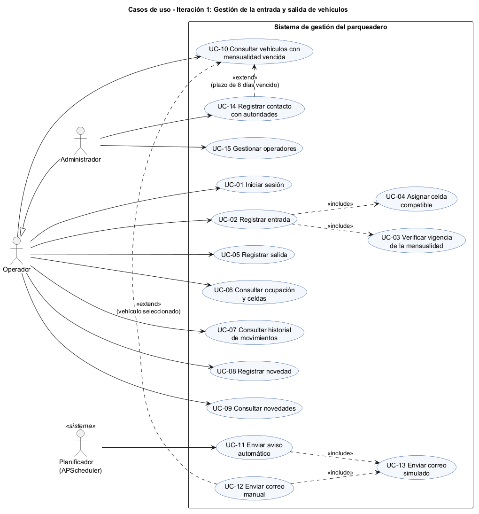
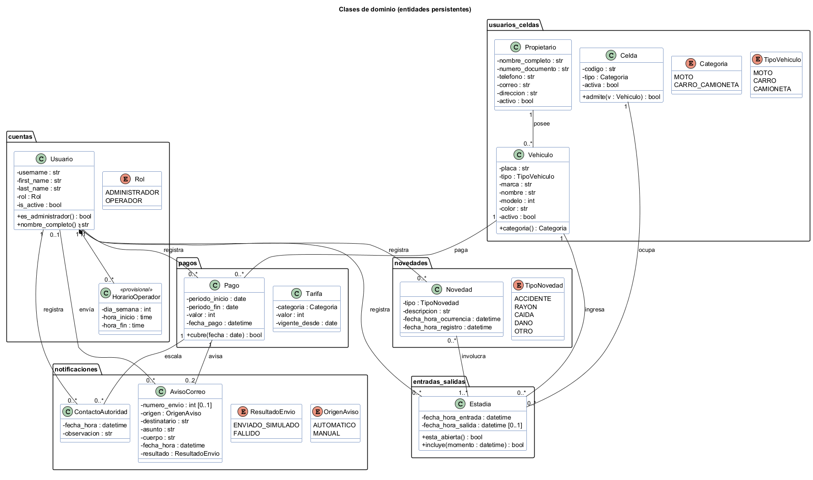
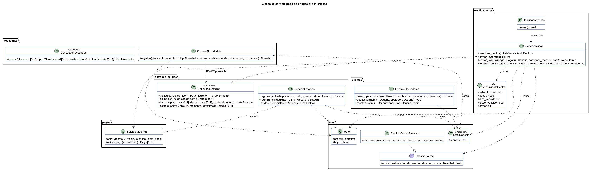
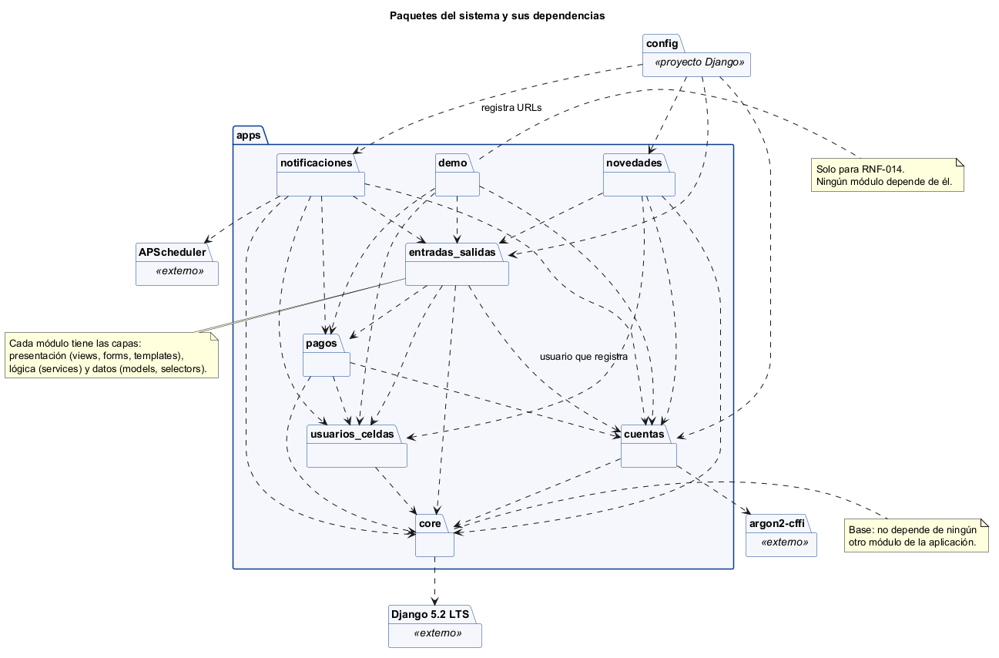

# Diseño UML — Iteración 1

**Proyecto:** Parqueadero "Autos Colombia"
**Versión:** 1
**Fecha:** 2026-11-15
**Base:** Requerimientos v2.10, HU-001 a HU-011, Arquitectura v1 y Modelo de datos v1.1 (todo aprobado).
**Estado:** **Aprobado** por el equipo del proyecto el 2026-11-15.

| Diagrama | Archivo (`docs/latex/diagrams/uml/`) |
|---|---|
| UC-01 Casos de uso | `UC-01_CasosUso.puml` / `.png` |
| CL-01 Clases de dominio | `CL-01_Dominio.puml` / `.png` |
| CL-02 Clases de servicio e interfaces | `CL-02_Servicios.puml` / `.png` |
| PK-01 Paquetes | `PK-01_Paquetes.puml` / `.png` |

---

## 1. Diagrama de casos de uso (UC-01)

### 1.1. Actores

| Actor | Descripción |
|---|---|
| Operador | Personal de portería. |
| Administrador | **Especializa al Operador** (generalización): puede hacer todo lo que hace el operador y además gestionar operadores y registrar el contacto con autoridades. |
| Planificador (APScheduler) | Actor de sistema que dispara el aviso automático al iniciar y cada hora (DEC-008). |

### 1.2. Relaciones entre casos de uso

- **UC-02 Registrar entrada** «include» **UC-03 Verificar vigencia** y **UC-04 Asignar celda**: siempre forman parte de la entrada (RF-002, RF-003).
- **UC-11 Aviso automático** y **UC-12 Correo manual** «include» **UC-13 Enviar correo simulado**: comparten el armado del mensaje, el envío simulado y su registro.
- **UC-12 Correo manual** «extend» **UC-10 Consultar vencidos**, en el punto de extensión "vehículo seleccionado": es opcional, desde la lista.
- **UC-14 Registrar contacto con autoridades** «extend» **UC-10**, con la condición "plazo de 8 días vencido". Solo lo ejecuta el administrador.

### 1.3. Especificaciones

#### UC-01 Iniciar sesión
- **Actor:** Operador (y Administrador por generalización).
- **Precondición:** el usuario existe y está activo.
- **Flujo principal:** 1. Ingresa usuario y contraseña. 2. El sistema verifica las credenciales (Argon2). 3. Muestra el menú según el rol.
- **Excepciones:** credenciales inválidas → "Usuario o contraseña incorrectos" (sin decir cuál de los dos falló). Usuario inactivo → no puede iniciar sesión (RF-106).
- **Postcondición:** sesión iniciada.
- **Trazabilidad:** RNF-001, RNF-002, RF-106.

#### UC-02 Registrar entrada
- **Actor:** Operador. **Trazabilidad:** RF-001, HU-001.
- **Precondición:** sesión iniciada.
- **Flujo principal:**
  1. El operador escribe la placa y pulsa Buscar.
  2. El sistema muestra los datos del vehículo y el estado de la mensualidad (**incluye UC-03**).
  3. El sistema ofrece las celdas libres compatibles (**incluye UC-04**).
  4. El operador elige la celda y confirma.
  5. El sistema, en una transacción, crea la estadía con la hora del servidor y el operador; la celda queda ocupada.
  6. Muestra la confirmación.
- **Flujos alternativos y excepciones:**
  - 2a. La placa no existe → "Vehículo no registrado".
  - 2b. El vehículo ya está dentro → "El vehículo ya se encuentra dentro" (RN-04).
  - 2c. Mensualidad no vigente (también si salió vencido y no ha pagado) → "Mensualidad no vigente" (RN-03, RN-13).
  - 3a. No hay celdas libres del tipo → "No hay celdas disponibles para este tipo de vehículo".
  - 5a. Otra persona ocupó la celda al mismo tiempo → la base de datos rechaza la operación y se muestra "La celda está ocupada" (RNF-003).
- **Postcondición:** estadía abierta y celda ocupada.

#### UC-03 Verificar vigencia de la mensualidad
- **Incluido por:** UC-02. **Trazabilidad:** RF-002, RN-03, RN-10.
- **Flujo:** consulta el último pago del vehículo y comprueba que su periodo cubra la fecha actual.
- **Resultado:** vigente / no vigente (con la fecha de vencimiento).

#### UC-04 Asignar celda compatible
- **Incluido por:** UC-02. **Trazabilidad:** RF-003, RN-05, RN-08, RN-09.
- **Flujo:** lista las celdas activas y libres de la categoría del vehículo (moto → MOTO; carro o camioneta → CARRO_CAMIONETA) y valida la celda elegida.
- **Excepción:** celda incompatible → "La celda no corresponde al tipo de vehículo".

#### UC-05 Registrar salida
- **Actor:** Operador. **Trazabilidad:** RF-004, HU-002.
- **Flujo principal:** 1. Escribe la placa. 2. El sistema muestra la estadía abierta. 3. El operador confirma. 4. El sistema cierra la estadía con la hora del servidor y el operador; la celda queda libre.
- **Alternativo:** mensualidad vencida → se informa, pero la salida se permite (RN-13).
- **Excepción:** sin estadía abierta → "El vehículo no se encuentra dentro".
- **Postcondición:** estadía cerrada; si estaba en proceso de retiro, deja de aparecer en UC-10.

#### UC-06 Consultar ocupación y celdas
- **Actor:** Operador. **Trazabilidad:** RF-005, HU-003.
- **Flujo:** lista los vehículos dentro (placa, tipo, celda, ingreso), con filtro por tipo y contadores por categoría. Permite consultar un código de celda: ocupada (placa y hora) o disponible.

#### UC-07 Consultar historial de movimientos
- **Actor:** Operador / Administrador. **Trazabilidad:** RF-006, HU-004.
- **Flujo:** filtra por placa y rango de fechas de ingreso; muestra celda, ingreso, salida y usuarios.

#### UC-08 Registrar novedad
- **Actor:** Operador. **Trazabilidad:** RF-007, HU-005, RN-14 a RN-16, RN-18.
- **Flujo principal:**
  1. Agrega una o varias placas.
  2. Elige el tipo, la fecha y hora del hecho, y escribe la descripción.
  3. El sistema verifica, para **cada** placa, que el vehículo estaba dentro a esa hora (que exista una estadía que la incluya).
  4. Crea la novedad con su identificador y la vincula a la estadía de cada vehículo.
  5. Muestra el identificador.
- **Excepciones:** algún vehículo no estaba dentro → se rechaza la novedad completa indicando la placa. Falta la descripción o los vehículos → rechazo. La hora del hecho es posterior a la actual → rechazo.
- **Postcondición:** novedad registrada, sin estado y sin opción de borrado.

#### UC-09 Consultar novedades
- **Actor:** Operador / Administrador. **Trazabilidad:** RF-008, HU-006.
- **Flujo:** filtra por placa, tipo y fechas; orden de la más reciente a la más antigua; una novedad con varios vehículos aparece al buscar cualquiera de ellos.

#### UC-10 Consultar vehículos con mensualidad vencida
- **Actor:** Operador. **Trazabilidad:** RF-009, HU-007, RN-11, RN-12, RN-17.
- **Flujo:** lista los vehículos con estadía abierta cuyo último pago ya venció: placa, propietario, fecha de vencimiento, días vencidos, correos enviados y estado ("En plazo" o "Plazo vencido – contactar autoridades" desde el día vencimiento + 8).
- **Puntos de extensión:** "vehículo seleccionado" (UC-12) y "plazo vencido" (UC-14).
- **Regla:** un vehículo que paga deja de aparecer, porque la lista se calcula en cada consulta (RN-17).

#### UC-11 Enviar aviso automático
- **Actor:** Planificador. **Trazabilidad:** RF-010, HU-008, RN-11, RN-21, DEC-008.
- **Flujo:** al iniciar el servidor y cada hora, para cada vencimiento de un vehículo dentro **sin primer correo exitoso**, ejecuta UC-13 con origen AUTOMÁTICO. Los vencimientos que quedaron pendientes con el servidor apagado se atienden al iniciar.
- **Regla:** el proceso es idempotente; no envía dos veces el primer correo.

#### UC-12 Enviar correo manual
- **Actor:** Operador. **Extiende:** UC-10. **Trazabilidad:** RF-012, HU-011, RN-22.
- **Flujo principal:** 1. Pulsa "Enviar correo" en un vehículo. 2. Si no hay correo previo, ejecuta UC-13 como envío 1.
- **Alternativo:** ya hay un primer correo → pide confirmación "¿Desea reenviarlo?"; si confirma, ejecuta UC-13 como envío 2.
- **Excepción:** ya existe el reenvío → "El correo de este vencimiento ya se reenvió una vez".

#### UC-13 Enviar correo simulado
- **Incluido por:** UC-11 y UC-12. **Trazabilidad:** DEC-007, RN-22, RNF-013.
- **Flujo:** arma el mensaje (placa, vencimiento, aviso de pago y advertencia con la fecha límite), llama a `ServicioCorreo` (implementación simulada) y registra el `AvisoCorreo` con el número de envío y el resultado.
- **Excepción:** fallo del envío → se registra como FALLIDO sin número (no cuenta para el límite, P-24) y no afecta otras operaciones.

#### UC-14 Registrar contacto con autoridades
- **Actor:** Administrador. **Extiende:** UC-10 (condición: plazo vencido). **Trazabilidad:** RF-011, HU-009.
- **Flujo:** escribe la observación y confirma; se registra con la fecha y el usuario. Se permiten varios contactos por vencimiento (P-25).
- **Excepción:** un operador intenta registrarlo → "acceso denegado".

#### UC-15 Gestionar operadores
- **Actor:** Administrador. **Trazabilidad:** RF-106, HU-010.
- **Flujo:** crear un operador (nombre, usuario y contraseña inicial); desactivar o reactivar uno existente.
- **Excepciones:** usuario repetido → "El nombre de usuario ya existe". Operador que intenta acceder → "acceso denegado".

---

## 2. Diagramas de clases

Los diagramas siguen la arquitectura aprobada: las **clases de dominio** son los modelos de Django (capa de datos) y las **clases de servicio** contienen las reglas de negocio (capa de lógica). Las vistas y los formularios (capa de presentación) no se modelan como clases, porque solo delegan en los servicios.

### 2.1. Clases de dominio (CL-01)

- Corresponden 1 a 1 a las tablas del modelo de datos aprobado; las multiplicidades son las del MER.
- `Usuario` **compone** a `HorarioOperador` (entidad débil, provisional).
- Los enumerados (`Rol`, `TipoVehiculo`, `Categoria`, `TipoNovedad`, `OrigenAviso`, `ResultadoEnvio`) se implementan como `TextChoices` de Django.
- Métodos de dominio, sin acceso a otros módulos:
  - `Vehiculo.categoria()`: moto → MOTO; carro o camioneta → CARRO_CAMIONETA.
  - `Celda.admite(v)`: compatibilidad RN-08.
  - `Pago.cubre(fecha)`: si el periodo incluye la fecha.
  - `Estadia.esta_abierta()` e `incluye(momento)`: presencia para RF-007.
  - `Usuario.es_administrador()`.

### 2.2. Clases de servicio e interfaces (CL-02)

| Clase | Responsabilidad | Requerimientos |
|---|---|---|
| `ServicioEstadias` | Entrada y salida con transacción; celdas disponibles. | RF-001 a RF-004 |
| `ConsultasEstadias` «selectors» | Consultas de solo lectura: dentro, ocupación de celda, historial, estadía en un momento. | RF-005, RF-006, RF-007 |
| `ServicioVigencia` | Vigencia de la mensualidad y último pago. | RF-002, RF-009 |
| `ServicioNovedades` / `ConsultasNovedades` | Registro con validación de presencia; búsqueda. | RF-007, RF-008 |
| `ServicioAvisos` | Vencidos dentro, avisos automáticos y manuales (límite RN-22), contacto con autoridades. | RF-009 a RF-012 |
| `VencimientoDentro` «dto» | Fila calculada de la lista de vencidos (no se guarda). | RF-009 |
| `PlanificadorAvisos` | Inicia APScheduler una sola vez y llama a `enviar_automaticos()`. | DEC-008 |
| `ServicioOperadores` | Crear, desactivar y reactivar operadores (solo administrador). | RF-106 |
| `Reloj` | Fecha y hora actuales; se sustituye en las pruebas. | Arquitectura 7.3 |
| `ServicioCorreo` «interface» / `ServicioCorreoSimulado` | Envío de correo; implementación simulada. | DEC-007 |
| `ErrorNegocio` «exception» | Error con un mensaje para el usuario. | Arquitectura 7.7 |

**Principios aplicados:**
- **Inversión de dependencias:** `ServicioAvisos` depende de la interfaz `ServicioCorreo`, no de la implementación.
- **Responsabilidad única:** los comandos están en los servicios y las consultas en los selectors.
- **Testabilidad:** el `Reloj` es sustituible en las pruebas.

---

## 3. Diagrama de paquetes (PK-01)

- `config` es el proyecto Django (ajustes y URLs raíz) y registra las URLs de los módulos.
- `core` es la base y no depende de otros módulos de la aplicación.
- `demo` solo existe para los datos de demostración y ningún módulo depende de él.
- **No hay ciclos.** El orden de dependencia es: `notificaciones`/`novedades` → `entradas_salidas` → `pagos` → `usuarios_celdas` → `core`, y todos los módulos con registros de usuario → `cuentas` → `core`.
- **Aclaración respecto a la arquitectura aprobada:** `entradas_salidas`, `novedades`, `notificaciones` y `pagos` también dependen de `cuentas`, porque guardan qué usuario registró cada operación (RNF-004). La dependencia no crea ciclos y no cambia ninguna decisión aprobada. El diagrama ARQ-03 no la dibujaba para no saturarlo.
- **Dependencias externas:** Django (base de todo), APScheduler (solo `notificaciones`) y argon2-cffi (solo `cuentas`).
