# Mockups — Iteración 1

**Proyecto:** Parqueadero "Autos Colombia"
**Versión:** 1
**Fecha:** 2026-11-15
**Base:** HU-001 a HU-011 y casos de uso UC-01 a UC-15.
**Estado:** **Aprobado** por el equipo del proyecto el 2026-11-15.

> **CHG-002 (aprobado 2026-11-15):** el estilo visual final sigue los diseños de referencia del equipo (`docs/referencias_ui/`), con las adaptaciones de `docs/Analisis_Referencias_UI.md`.

Los mockups son bocetos de baja fidelidad hechos con PlantUML Salt. Muestran **qué información y qué acciones** tiene cada pantalla, no el diseño visual final. Las fuentes están en `docs/latex/diagrams/mockups/`.

**Menú superior (todas las pantallas):** Ocupación · Entrada · Salida · Novedades · Vencidos · Historial · Operadores · Salir. La opción **Operadores** solo aparece para el administrador (RNF-002).

| Mockup | Pantalla | HU / UC |
|---|---|---|
| M-01 | Inicio de sesión | UC-01 |
| M-02 | Registrar entrada | HU-001 / UC-02 a UC-04 |
| M-03 | Registrar salida | HU-002 / UC-05 |
| M-04 | Ocupación y consulta de celda | HU-003 / UC-06 |
| M-05 | Historial de movimientos | HU-004 / UC-07 |
| M-06 | Registrar novedad | HU-005 / UC-08 |
| M-07 | Consultar novedades | HU-006 / UC-09 |
| M-08 | Vehículos dentro con mensualidad vencida | HU-007, HU-009, HU-011 / UC-10, UC-12, UC-14 |
| M-09 | Confirmar reenvío del correo | HU-011 / UC-12 |
| M-10 | Correo enviado (simulación) | HU-008, HU-011 / UC-11 a UC-13 |
| M-11 | Registrar contacto con autoridades | HU-009 / UC-14 |
| M-12 | Gestión de operadores | HU-010 / UC-15 |

---

## M-01 Inicio de sesión
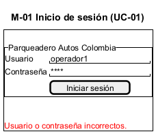

Si las credenciales fallan, el mensaje no dice si el error está en el usuario o en la contraseña (RNF-001).

## M-02 Registrar entrada
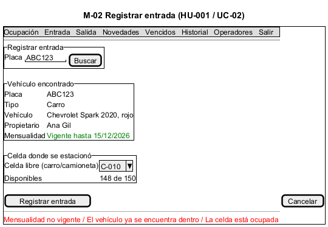

- **Flujo:** escribir la placa → Buscar → elegir la celda → Registrar entrada. Son **dos acciones** después de la placa, como pide RNF-005.
- La lista de celdas solo muestra celdas libres del tipo correcto (RN-08).
- La zona roja muestra los errores de HU-001: mensualidad no vigente, vehículo ya dentro, celda ocupada, vehículo no registrado y sin celdas.

## M-03 Registrar salida
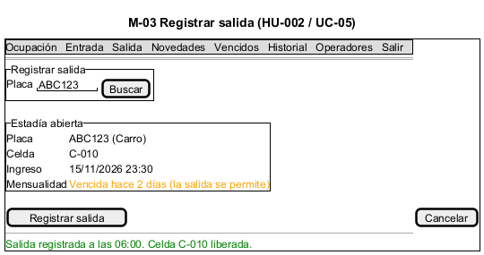

Si la mensualidad está vencida, se informa en naranja, pero la salida se permite (RN-13). El ejemplo muestra una estadía que cruza la medianoche.

## M-04 Ocupación y consulta de celda
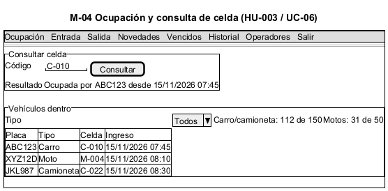

Consulta por código de celda (ocupada por qué placa, o disponible), contadores por categoría y lista filtrable de vehículos dentro.

## M-05 Historial de movimientos
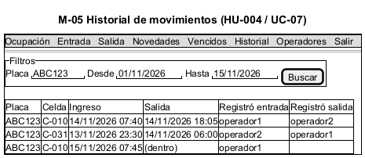

Filtros por placa y rango de fechas; muestra quién registró la entrada y la salida (RNF-004).

## M-06 Registrar novedad
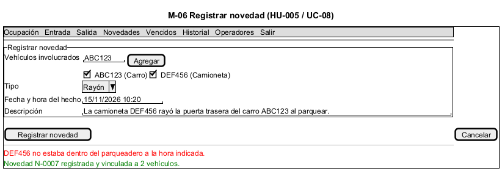

- Se agregan varias placas a la misma novedad (RN-14).
- Se pide la fecha y hora **del hecho**, que puede ser anterior a la salida del vehículo (RN-16).
- Si alguna placa no estaba dentro a esa hora, se rechaza todo y se indica cuál.
- Sin adjuntos (RN-18).

## M-07 Consultar novedades
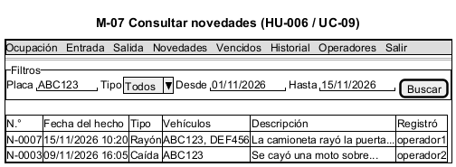

La novedad N-0007 aparece con sus dos vehículos y no tiene estado ni botón de borrar (RN-07, RN-15).

## M-08 Vehículos dentro con mensualidad vencida
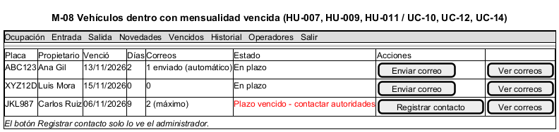

- **Días** y **Estado**: desde el día vencimiento + 8 aparece "Plazo vencido – contactar autoridades" (RN-12). Ejemplo: venció el 06/11 y el 15/11 lleva 9 días.
- **Correos:** cuántos se enviaron y de qué origen. Con 2 envíos (el máximo) ya no aparece el botón "Enviar correo" (RN-22).
- "Registrar contacto" solo lo ve el administrador.
- Un vehículo que paga o sale desaparece de la lista (RN-17).

## M-09 Confirmar reenvío
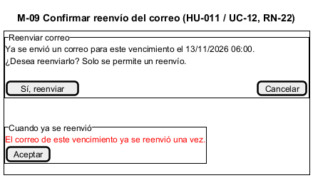

Diálogo de confirmación del único reenvío permitido, y el mensaje que aparece cuando ya se reenvió (RN-22).

## M-10 Correo enviado (simulación)
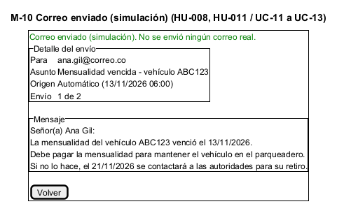

Muestra el contenido completo del correo simulado (DEC-007): destinatario, asunto, origen, número de envío y texto con el aviso de pago y la fecha límite (vencimiento + 8 días). Sirve para la demostración ante el profesor.

## M-11 Registrar contacto con autoridades
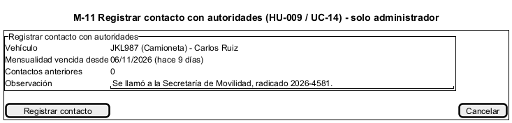

Solo para el administrador. Muestra los contactos anteriores, porque se permiten varios (P-25).

## M-12 Gestión de operadores
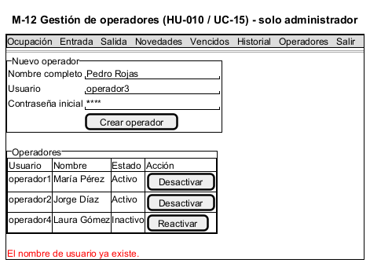

Crear operadores y desactivarlos o reactivarlos; no hay opción de borrar (RN-07). Los horarios se agregarán en la iteración 2 (RF-107).

---

## Datos de ejemplo

Los nombres, placas y fechas de los mockups son **ficticios** e ilustrativos. Son coherentes entre sí: por ejemplo, ABC123 venció el 13/11/2026, el correo automático salió ese día y la fecha límite es el 21/11/2026.
