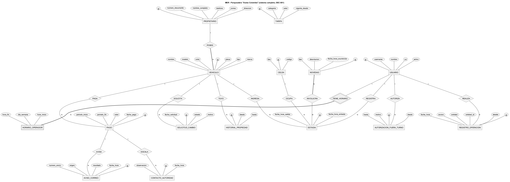
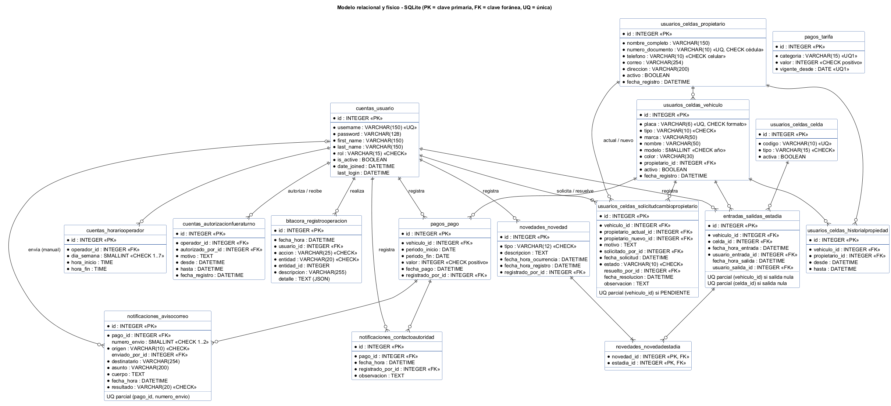

# Modelo de datos — Parqueadero "Autos Colombia"

**Versión:** 1.1
**Fecha:** 2026-11-15
**Base:** Requerimientos v2.9, HU-001 a HU-011, Arquitectura v1 y DEC-001 a DEC-012 (todo aprobado).
**Estado:** **Aprobado** por el equipo del proyecto el 2026-11-15 (versión 1.1, con las interpretaciones de la sección 6).

| Versión | Cambios |
|---|---|
| 1 | Borrador inicial. |
| 1.3 | Iteración 2 (sección 7). **Aprobada** por el equipo el 2026-11-15, incluidas DM-08 a DM-11. |
| 1.2 | CHG-002 (aprobado 2026-11-15): el tipo de novedad admite OBSERVACION; por eso la columna `tipo` de la novedad pasa de VARCHAR(10) a VARCHAR(12). |
| 1.1 | Respuestas del equipo a P-22 a P-25: formato de placa, datos del propietario (nombre completo, cédula, teléfono, correo, dirección) y del vehículo (marca, nombre, modelo, color); los envíos fallidos no cuentan para el límite; se permiten varios contactos con autoridades por vencimiento. |

**Alcance:** por **DEC-001**, este modelo cubre el **sistema completo** (las tres iteraciones), aunque en la iteración 1 solo se implementen las pantallas de entradas y salidas, novedades, avisos y operadores.

| Artefacto | Archivo |
|---|---|
| MER (notación de Chen) | `docs/latex/diagrams/datos/MER-01_Chen.puml` / `.png` |
| Modelo relacional y físico (pata de gallo) | `docs/latex/diagrams/datos/MR-01_Relacional.puml` / `.png` |
| Script DDL para SQLite | `docs/sql/ddl_sqlite_v1.sql` |
| Validación automática del DDL | `docs/sql/validar_ddl.py` |

---

## 1. Modelo Entidad-Relación (MER)

### 1.1. Entidades

| Entidad | Qué representa | Origen |
|---|---|---|
| USUARIO | Persona que usa el sistema: administrador u operador. | RNF-001, RNF-002, RF-106 |
| HORARIO_OPERADOR | Franja de trabajo de un operador. **Entidad débil**: no existe sin su operador. **Provisional:** sus atributos se confirmarán en la iteración 2. | RF-107 |
| PROPIETARIO | Cliente mensualista dueño de uno o varios vehículos. | RF-101, DEC-002 |
| VEHICULO | Vehículo registrado (moto, carro o camioneta). | RF-102, RN-02 |
| CELDA | Espacio físico de parqueo, de tipo moto o carro/camioneta. | RF-103, RN-08, RN-20 |
| TARIFA | Valor mensual por categoría de vehículo, con fecha de vigencia. | RF-204, RN-19 |
| PAGO | Pago de una mensualidad de un vehículo para un periodo. Su `periodo_fin` es la **fecha de vencimiento**. | RF-201, RN-10 |
| ESTADIA | Permanencia de un vehículo en una celda: entrada y, cuando ocurre, salida. | RF-001, RF-004 |
| NOVEDAD | Hecho ocurrido dentro de las instalaciones (accidente, rayón, caída, daño, otro). | RF-007, RN-14 a RN-16, RN-18 |
| AVISO_CORREO | Cada intento de enviar (simulado) el correo de retiro por un vencimiento. | RF-010, RF-012, RN-11, RN-21, RN-22 |
| CONTACTO_AUTORIDAD | Registro de que el administrador contactó a las autoridades por un vencimiento. | RF-011, RN-12 |

### 1.2. Relaciones y cardinalidades

| Relación | Cardinalidad | Participación | Justificación |
|---|---|---|---|
| PROPIETARIO **posee** VEHICULO | 1 : N | Vehículo **total** (siempre tiene dueño); propietario parcial (puede registrarse antes de su vehículo). | RN-10: un cliente puede tener varios vehículos. |
| VEHICULO **paga** PAGO | 1 : N | Pago total. | La mensualidad se paga por vehículo (RN-10). |
| VEHICULO **ingresa** ESTADIA | 1 : N | Estadía total. | Un vehículo entra muchas veces, pero tiene como máximo **una estadía abierta** (RN-04). |
| CELDA **ocupa** ESTADIA | 1 : N | Estadía total. | Una celda se usa muchas veces, pero tiene como máximo **una estadía abierta** (RN-05). |
| NOVEDAD **involucra** ESTADIA | N : M | Novedad total (al menos una estadía); estadía parcial. | RN-14: una novedad puede vincular varios vehículos. Se vincula a la **estadía** y no solo al vehículo para probar que el vehículo estaba dentro en la hora del hecho (RF-007). |
| PAGO **avisa** AVISO_CORREO | 1 : N (máximo 2 exitosos) | Aviso total. | El vencimiento se identifica por el pago que venció. Como máximo un primer correo y un reenvío (RN-11, RN-22). |
| PAGO **escala** CONTACTO_AUTORIDAD | 1 : N | Contacto total. | Ver P-25. |
| USUARIO **tiene** HORARIO_OPERADOR | 1 : N (identificadora) | Horario total. | RF-107 (provisional). |
| USUARIO **registra** ESTADIA, NOVEDAD, PAGO, CONTACTO; **envía** AVISO manual | 1 : N | Total en el registro, salvo el aviso automático, que no tiene usuario. | Trazabilidad (RNF-004). El diagrama solo dibuja "registra ESTADIA" para no saturarlo; las demás aparecen en el modelo relacional. |

**TARIFA** no se relaciona con PAGO por clave foránea: el pago **copia** el valor vigente al momento de pagar (decisión DM-04).

### 1.3. Restricciones del dominio

| Restricción | Regla |
|---|---|
| Tipo de vehículo ∈ {MOTO, CARRO, CAMIONETA} | RN-02 |
| Tipo de celda y categoría de tarifa ∈ {MOTO, CARRO_CAMIONETA} | RN-08, RN-19 |
| Moto → celda MOTO; carro o camioneta → celda CARRO_CAMIONETA | RN-08 (se valida en el servicio, porque el tipo de vehículo está en otra tabla) |
| La novedad ocurre dentro de una estadía de cada vehículo vinculado | RN-16, RF-007 (se valida en el servicio) |
| Los registros no se borran | RN-07 |

---

## 2. Decisiones de diseño del modelo (se aprueban con este documento)

| ID | Decisión | Alternativa descartada | Por qué |
|---|---|---|---|
| DM-01 | El estado "ocupada/libre" de una celda **se calcula**: una celda está ocupada si tiene una estadía abierta. | Guardar una columna `ocupada` en la celda. | Evita datos duplicados que se pueden contradecir. La restricción única parcial garantiza RN-05 y el índice hace la consulta rápida. |
| DM-02 | La novedad se vincula a la **estadía** (tabla asociativa NOVEDAD–ESTADIA). | Vincularla al vehículo. | El vehículo se obtiene de la estadía, sin redundancia, y queda probado que estaba dentro (RF-007). |
| DM-03 | El **vencimiento** se identifica por el **pago** cuyo `periodo_fin` pasó. AVISO_CORREO tiene un `numero_envio` (1 = primero, 2 = reenvío) con unicidad por pago. | Una entidad "vencimiento" o "proceso de retiro" con estado propio. | El proceso de retiro se **calcula** (vehículo dentro + último pago vencido), así que RN-17 se cumple sola al pagar. La base de datos impone RN-11 y RN-22. |
| DM-04 | **Desnormalización controlada:** el pago guarda una copia de `valor`, y el aviso guarda `destinatario`, `asunto` y `cuerpo`. | Calcularlos desde la tarifa y el propietario. | Son evidencia histórica: si la tarifa o el correo cambian después, el registro debe mostrar lo que realmente se cobró o se envió. |
| DM-05 | Borrado **restringido** (`ON DELETE RESTRICT`) en todas las claves foráneas, y desactivación con `activo` / `is_active`. | Borrado en cascada. | RN-07 y RNF-004: nada se borra; propietarios, vehículos, celdas y usuarios se desactivan. |
| DM-06 | Valores en **pesos enteros** (`INTEGER`). | Decimal con centavos. | El peso colombiano se cobra sin centavos (150 000 y 80 000 COP). |
| DM-07 | Zona horaria `America/Bogota` y fechas guardadas por Django en UTC. | Guardar hora local. | Decisión de la arquitectura (7.3). Evita errores en los cálculos de días. |

---

## 3. Modelo relacional (MR)

Notación: **PK** clave primaria, **FK** clave foránea, **UQ** única, **NN** no nulo.

| Tabla | Columnas (PK subrayada en el diagrama) | Claves y restricciones |
|---|---|---|
| `cuentas_usuario` | id, username, password, first_name, last_name, rol, is_active, date_joined, last_login | PK id · UQ username · CHECK rol ∈ {ADMINISTRADOR, OPERADOR} · NN salvo last_login |
| `cuentas_horariooperador` (provisional) | id, operador_id, dia_semana, hora_inicio, hora_fin | PK id · FK operador_id → usuario · CHECK dia_semana 1..7 |
| `usuarios_celdas_propietario` | id, nombre_completo, numero_documento, telefono, correo, direccion, activo, fecha_registro | PK id · UQ numero_documento · CHECK cédula (solo dígitos, 5 a 10) · correo NN (DEC-002) |
| `usuarios_celdas_vehiculo` | id, placa, tipo, marca, nombre, modelo, color, propietario_id, activo, fecha_registro | PK id · UQ placa · CHECK formato de placa (RN-23) · CHECK tipo · CHECK modelo (año) 1950–2100 · FK propietario_id |
| `usuarios_celdas_celda` | id, codigo, tipo, activa | PK id · UQ codigo · CHECK tipo |
| `pagos_tarifa` | id, categoria, valor, vigente_desde | PK id · UQ (categoria, vigente_desde) · CHECK valor > 0 |
| `pagos_pago` | id, vehiculo_id, periodo_inicio, periodo_fin, valor, fecha_pago, registrado_por_id | PK id · FK vehiculo_id, registrado_por_id · CHECK periodo_fin ≥ periodo_inicio, valor > 0 |
| `entradas_salidas_estadia` | id, vehiculo_id, celda_id, fecha_hora_entrada, usuario_entrada_id, fecha_hora_salida, usuario_salida_id | PK id · 4 FK · CHECK salida > entrada · CHECK salida y usuario_salida nulos a la vez · **UQ parcial** vehiculo_id y **UQ parcial** celda_id cuando la salida es nula |
| `novedades_novedad` | id, tipo, descripcion, fecha_hora_ocurrencia, fecha_hora_registro, registrado_por_id | PK id · FK registrado_por_id · CHECK tipo · CHECK descripción no vacía · CHECK ocurrencia ≤ registro |
| `novedades_novedadestadia` | novedad_id, estadia_id | PK (novedad_id, estadia_id) · 2 FK |
| `notificaciones_avisocorreo` | id, pago_id, numero_envio, origen, enviado_por_id, destinatario, asunto, cuerpo, fecha_hora, resultado | PK id · FK pago_id, enviado_por_id · CHECK numero_envio ∈ {1,2} · CHECK manual ⇔ enviado_por no nulo · CHECK exitoso ⇔ numero_envio no nulo · **UQ parcial** (pago_id, numero_envio) |
| `notificaciones_contactoautoridad` | id, pago_id, fecha_hora, registrado_por_id, observacion | PK id · 2 FK · CHECK observación no vacía |

### 3.1. Dependencias funcionales principales

- `usuario.id → username, rol, …` y `username → id` (clave candidata).
- `propietario.id → nombre_completo, numero_documento, telefono, correo, direccion, …` y `numero_documento → id` (clave candidata).
- `vehiculo.id → placa, tipo, marca, nombre, modelo, color, propietario_id` y `placa → id` (clave candidata). Marca, nombre y modelo **no** forman una clave ni determinan otros atributos (dos vehículos pueden ser iguales), así que no hay dependencias transitivas.
- `celda.id → codigo, tipo` y `codigo → id`.
- `pago.id → vehiculo_id, periodo_inicio, periodo_fin, valor, …`.
- `estadia.id → vehiculo_id, celda_id, fechas y usuarios`.
- `novedadestadia`: no hay atributos fuera de la clave.
- `avisocorreo.id → …` y `(pago_id, numero_envio) → id` cuando numero_envio no es nulo.

### 3.2. Normalización

| Forma normal | Verificación |
|---|---|
| **1FN** | Todos los atributos son atómicos. Los vehículos de una novedad no se guardan como lista, sino en la tabla asociativa `novedadestadia`. No hay grupos repetidos. |
| **2FN** | Todas las tablas con clave simple cumplen trivialmente. La única clave compuesta (`novedadestadia`) no tiene atributos fuera de la clave. |
| **3FN** | Ningún atributo no clave depende de otro atributo no clave. El vehículo de una novedad **no** se repite (se obtiene de la estadía, DM-02), y el estado de la celda no se guarda (DM-01). |
| **Excepciones justificadas** | Copias históricas de DM-04 (`pago.valor`, `avisocorreo.destinatario/asunto/cuerpo`). No violan la 3FN en sentido estricto, porque representan el valor **en el momento del hecho** y no dependen del valor actual de la tarifa o del propietario. |

---

## 4. Modelo físico (SQLite 3)

El script completo está en `docs/sql/ddl_sqlite_v1.sql`. En la implementación, las tablas las crean las **migraciones de Django** desde los modelos, que deben reproducir estas columnas, restricciones e índices. El script sirve como especificación y para validar el diseño.

### 4.1. Tipos de datos

| Tipo lógico | Tipo en SQLite / Django | Uso |
|---|---|---|
| Identificador | `INTEGER PRIMARY KEY AUTOINCREMENT` / `BigAutoField` | Todas las PK simples |
| Texto corto | `VARCHAR(n)` / `CharField(max_length=n)` | Placa (6), cédula (10), código de celda (10), marca y nombre del vehículo (50), color (30), dirección (200), correo (254, estándar de Django) |
| Texto largo | `TEXT` / `TextField` | Descripción de novedad, cuerpo del correo, observación |
| Enumerado | `VARCHAR` + `CHECK` / `CharField(choices=…)` + `CheckConstraint` | Rol, tipos, origen, resultado |
| Fecha | `DATE` / `DateField` | Periodo del pago, vigencia de tarifa |
| Fecha y hora | `DATETIME` / `DateTimeField` (UTC, `USE_TZ=True`) | Entradas, salidas, registros |
| Dinero | `INTEGER` / `PositiveIntegerField` | Valores en COP (DM-06) |
| Año | `SMALLINT` / `PositiveSmallIntegerField` | Modelo del vehículo |
| Booleano | `BOOLEAN` / `BooleanField` | `activo`, `is_active` |

**Nota sobre SQLite:** SQLite tiene tipado flexible; los tipos declarados documentan la intención y Django valida los valores antes de guardarlos. Las restricciones `CHECK`, `UNIQUE` y de clave foránea sí las aplica el motor (Django activa `PRAGMA foreign_keys`).

### 4.2. Índices

| Índice | Tabla | Propósito |
|---|---|---|
| `uq_estadia_vehiculo_abierta` (único parcial) | estadia (vehiculo_id) si salida nula | RN-04 y búsqueda de la estadía abierta de una placa (RF-001, RF-004) |
| `uq_estadia_celda_abierta` (único parcial) | estadia (celda_id) si salida nula | RN-05, ocupación y consulta de celda (RF-003, RF-005) |
| `idx_estadia_vehiculo_entrada` | estadia (vehiculo_id, fecha_hora_entrada) | Historial por placa (RF-006) y validación de presencia en una novedad (RF-007) |
| `idx_estadia_entrada` | estadia (fecha_hora_entrada) | Historial por rango de fechas (RF-006) |
| `idx_pago_vehiculo_fin` | pago (vehiculo_id, periodo_fin) | Vigencia de la mensualidad (RF-002) y vencimientos (RF-009) |
| `uq_aviso_envio` (único parcial) | avisocorreo (pago_id, numero_envio) | RN-11 y RN-22 |
| `idx_novedad_ocurrencia` | novedad (fecha_hora_ocurrencia) | Consulta de novedades por fechas (RF-008) |
| `idx_novedadestadia_estadia`, `idx_vehiculo_propietario`, `idx_celda_tipo`, `idx_contacto_pago`, `idx_horario_operador` | — | Claves foráneas y filtros frecuentes |
| Índices de las restricciones `UNIQUE` | placa, código, username, documento | Búsquedas directas |

Esto cubre la parte de datos de **RNF-006**: se verificó con `EXPLAIN QUERY PLAN` que la búsqueda de la estadía abierta de un vehículo usa `uq_estadia_vehiculo_abierta`.

### 4.3. Valores por defecto e integridad

- `activo`, `activa` e `is_active` valen 1 por defecto.
- Las fechas de registro las asigna la aplicación con el reloj del sistema (no con valores por defecto de la base de datos), para poder simularlas en las pruebas.
- Todas las claves foráneas usan `ON DELETE RESTRICT` (DM-05).
- Las reglas que cruzan tablas (RN-03 vigencia, RN-08 compatibilidad, RN-16 presencia y RN-22 confirmación) se validan en los servicios, dentro de transacciones.

### 4.4. Validación realizada

Ejecuté el DDL en SQLite 3.50.4 con `docs/sql/validar_ddl.py`: **42 comprobaciones, 42 pasan, 0 fallan** (versión 1.1). Entre ellas:
- se rechaza una segunda estadía abierta del mismo vehículo (RN-04) y otra estadía abierta en una celda ocupada (RN-05);
- se acepta una salida que cruza la medianoche y se rechaza una salida anterior a la entrada;
- una novedad puede vincularse a dos estadías y no se puede duplicar el vínculo;
- se rechazan un segundo "primer correo" y un segundo reenvío (RN-11, RN-22);
- no se puede borrar un vehículo con estadías (RN-07);
- se aceptan las placas `ABC123`, `ABC12D` y `ABC12`, y se rechazan las minúsculas y otros formatos (RN-23);
- se rechazan una cédula con letras y un modelo fuera de rango;
- se aceptan dos contactos con autoridades para el mismo vencimiento (P-25).

---

## 5. Trazabilidad RF → tablas

| RF | Tablas |
|---|---|
| RF-001, RF-003, RF-004, RF-005, RF-006 | estadia, vehiculo, celda, usuario |
| RF-002 | pago, vehiculo |
| RF-007, RF-008 | novedad, novedadestadia, estadia |
| RF-009, RF-010, RF-012 | estadia, pago, avisocorreo, propietario |
| RF-011 | contactoautoridad, pago |
| RF-106 | usuario |
| RF-101 a RF-105 (iteración 2) | propietario, vehiculo, celda |
| RF-107 (iteración 2) | horariooperador (provisional) |
| RF-201 a RF-204 (iteración 3) | pago, tarifa |
| RNF-014 (datos de demostración) | todas |

---

## 6. Preguntas resueltas (2026-11-15)

| ID | Respuesta del equipo | Dónde quedó |
|---|---|---|
| P-22 | Formato de placa aprobado: carro y camioneta `ABC123`; moto `ABC12D` o `ABC12`. | RN-23, CHECK en `vehiculo.placa` |
| P-23 | Propietario: nombre completo, cédula (CC), teléfono, correo y dirección. Vehículo: marca, nombre, modelo y color. | `propietario`, `vehiculo`; RF-101 y RF-102 |
| P-24 | Los envíos fallidos no cuentan para el límite de RN-22. | RN-22, `avisocorreo` (fallidos sin `numero_envio`) |
| P-25 | Se permiten varios contactos con autoridades por vencimiento. | RF-011, `contactoautoridad` sin restricción de unicidad |

**Interpretaciones aprobadas junto con el modelo:**
- **Modelo:** se entiende como el **año** del vehículo (uso habitual en Colombia), por ejemplo 2020.
- **Nombre:** se entiende como la **línea o referencia** del vehículo, por ejemplo "Spark".
- **Documento:** solo cédula de ciudadanía, por eso ya no hay columna de tipo de documento.
- **Coherencia entre placa y tipo:** que una moto tenga placa de moto y un carro placa de carro se valida en la aplicación (RN-23).
- **HORARIO_OPERADOR** sigue provisional hasta la iteración 2.

---

## 7. Cambios del modelo v1.3 — Iteración 2 (aprobado el 2026-11-15)

**Base:** requerimientos de la iteración 2 v1.4 y DEC-013 a DEC-015 (aprobados).
**Validación:** `docs/sql/validar_ddl.py` con el DDL v1.3: **60 comprobaciones, 60 pasan**. Son las 42 anteriores más 18 nuevas.

### 7.1. Tablas nuevas y modificadas

| Tabla | Cambio | Origen | Restricciones principales |
|---|---|---|---|
| `usuarios_celdas_propietario` | `telefono` pasa a `VARCHAR(10)` con validación de celular | RN-30 | CHECK `telefono GLOB '3' + 9 dígitos` |
| `cuentas_horariooperador` | **Deja de ser provisional.** Franjas por día (1 = lunes … 7 = domingo); si `hora_fin < hora_inicio`, la franja cruza la medianoche | DEC-014, RN-36, P-37 | CHECK día 1..7; inicio ≠ fin. Que no se crucen dos franjas del mismo día (RN-37) se valida en el servicio, porque depende de otras filas. |
| `cuentas_autorizacionfueraturno` (nueva) | operador, autorizado por, motivo, desde, hasta, fecha de registro | RF-110, RN-32 | CHECK hasta > desde; el operador no se autoriza a sí mismo; motivo no vacío |
| `usuarios_celdas_solicitudcambiopropietario` (nueva) | vehículo, propietario actual, propietario nuevo, motivo, solicitado por, fecha, estado, resuelto por, fecha de resolución, observación | RF-109, RN-33, DEC-015 | Estado ∈ {PENDIENTE, APROBADA, RECHAZADA}; nuevo ≠ actual; PENDIENTE ⇔ sin resolución; **UQ parcial**: una sola pendiente por vehículo |
| `usuarios_celdas_historialpropiedad` (nueva) | **propietarios anteriores**: vehículo, propietario, desde, hasta | RN-33, DEC-015 | CHECK hasta > desde |
| `bitacora_registrooperacion` (nueva) | fecha y hora, usuario, acción, entidad, id de la entidad, descripción, detalle (JSON con los valores antes y después) | RF-111, RN-34, DEC-013 | Acción y entidad acotadas por CHECK; índices por entidad, por usuario y fecha, y por fecha |

### 7.2. Decisiones de diseño del modelo (aprobadas con esta versión)

| ID | Decisión | Alternativa descartada | Por qué |
|---|---|---|---|
| DM-08 | La bitácora va en un **módulo nuevo `bitacora`**. Depende **solo de `core`** y referencia al usuario con `settings.AUTH_USER_MODEL` (corrección aprobada el 2026-11-15 con el diseño de la iteración 2, para evitar el ciclo con `cuentas`); los módulos que registran operaciones dependen de él. | Ponerla en `core` (crearía un ciclo, porque necesita al usuario de `cuentas`) o en `cuentas` (mezcla responsabilidades). | Mantiene las dependencias sin ciclos (arquitectura, sección 4.2). **Agrega un noveno módulo a la arquitectura aprobada**, por eso requiere su aprobación. |
| DM-09 | `historialpropiedad` guarda **solo los propietarios anteriores**. El actual sigue en `vehiculo.propietario_id`, y su fecha de inicio es el `hasta` del último registro del historial (o la fecha de registro del vehículo). | Guardar también al propietario actual en el historial (con `hasta` nulo). | Evita duplicar el propietario actual en dos tablas que se podrían contradecir (3FN). |
| DM-10 | La bitácora es **polimórfica**: `entidad` + `entidad_id`, **sin clave foránea**. | Una tabla de bitácora por cada entidad, o una columna FK por cada tipo. | Una sola tabla cubre propietarios, vehículos, operadores, horarios, autorizaciones y solicitudes. Como nada se borra (RN-07), las referencias no quedan huérfanas. |
| DM-11 | La bitácora **no guarda contraseñas**: al restablecer una, solo registra que se hizo. | — | RNF-001, RNF-007. |

### 7.3. Normalización

- Las tablas nuevas están en **3FN**: sus atributos dependen solo de su clave.
- `solicitudcambiopropietario.propietario_actual_id` repite un dato del vehículo **en el momento de la solicitud**. Es una copia histórica, como DM-04: muestra a quién pertenecía el vehículo cuando se pidió el cambio.
- `bitacora.detalle` (JSON) no se consulta por sus partes; es un registro de lo que ocurrió, no datos de trabajo.

### 7.4. Trazabilidad

| RF | Tablas |
|---|---|
| RF-101, RF-102, RF-105, RF-108 | propietario, vehiculo, bitacora |
| RF-104 | celda, estadia |
| RF-106 | usuario, bitacora |
| RF-107 | horariooperador, bitacora |
| RF-109 | solicitudcambiopropietario, historialpropiedad, vehiculo, bitacora |
| RF-110 | autorizacionfueraturno, bitacora |
| RF-111 | bitacora |
